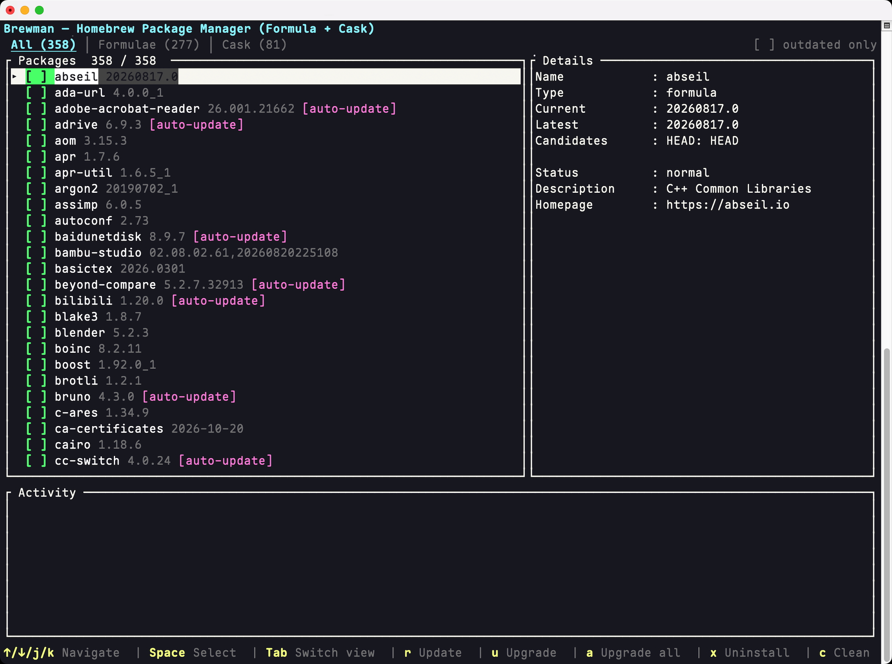

# Brewman

> Manage Homebrew formulae & casks from a fast Rust/Ratatui TUI — check versions, upgrade, and uninstall with keyboard shortcuts.

Brewman is a terminal user interface (TUI) built with **Rust + Ratatui** for managing Homebrew **formulae** and **casks** on macOS. Check package versions, update software sources, upgrade, or uninstall packages — all without leaving your terminal.

## Features

- **Unified package view**: Switch between All / Formulae / Cask with `Tab` (or `1` / `2` / `3`)
- **Clear version display**: Shows current, latest, and candidate versions for every package (HEAD builds, multiple installed versions)
- **One-key upgrades**: Upgrade a single package, a multi-selected group, or all outdated packages at once (with confirmation prompts)
- **Batch selection**: Mark multiple packages with `Space` and upgrade them together with a single `u` (formulae and casks are grouped into separate `brew upgrade` calls)
- **Live activity panel**: Bottom panel shows the command currently running, streams its real-time output (e.g. `==> Downloading`, `==> Pouring`), plus a colored history of recent results (done / failed)
- **Safe uninstall**: Uninstalls require explicit confirmation (Y/N)
- **Source update**: Built-in `brew update` to sync Homebrew sources and auto-refresh the list
- **Cleanup**: Run `brew cleanup` to remove old versions and cache with the `c` shortcut
- **Non-blocking design**: brew commands run sequentially on a background worker thread; the UI stays responsive and streams live feedback (the running command and its output) in the activity panel
- **Full transparency**: All command output (including errors) is shown in the details panel
- **Vim-style navigation**: `j/k`, `↑/↓`, `g/G` for fast movement; fully keyboard-driven

## UI Preview



## Installation

### Option 1: Global install (recommended)

```bash
cd Brewman
cargo install --path . --root /opt/homebrew
```

The `brewman` command will be added to your PATH (`/opt/homebrew/bin`) and can be run from any terminal:

```bash
brewman
```

> Note: `--root /opt/homebrew` targets the brew prefix directory. If `cargo` is not in your PATH, run `export PATH="/opt/homebrew/opt/rustup/bin:$PATH"` first.

### Option 2: Run from source

```bash
cargo run
```

## Key Bindings

| Key | Action |
|-----|--------|
| `↑` / `↓` or `j` / `k` | Navigate selection |
| `g` / `G` | Jump to top / bottom of the list |
| `Tab` (or `1` `2` `3`) | Switch All / Formulae / Cask |
| `Space` | Select / deselect the current package (for batch upgrade) |
| `u` | Upgrade selected package(s) — all selected at once when any are marked |
| `a` | Upgrade all outdated packages |
| `x` (or `d`) | Uninstall selected package |
| `r` | Update (`brew update`) |
| `c` | Clean (`brew cleanup`) |
| `l` | Reload package list |
| `o` | Toggle "outdated only" filter (show only outdated packages) |
| `m` | Open mirror selector for the next upgrade |
| `PgUp` / `PgDn` | Scroll the details panel |
| `q` / `Ctrl-C` | Quit |

Confirmations: Upgrade (single / multi-selected / all), and uninstall all first prompt for confirmation (`Y` to confirm, `N` or `Esc` to cancel). Note: switching tabs or reloading the list clears the current selection.

## Project Structure

```
src/
├── main.rs   # Entry point + event loop (crossterm polling, non-TTY detection)
├── app.rs    # App state, key handling, background message consumption
├── brew.rs   # Background worker thread running brew commands sequentially (mpsc)
├── model.rs  # Package data model + brew info/outdated JSON v2 parsing
└── ui.rs     # Ratatui rendering (top bar / Tabs / list / details / activity panel / help bar)
```

## Testing

```bash
cargo test
```

Includes pure unit tests (JSON parsing and sorting) plus a real-environment integration test that actually invokes `brew info --json=v2 --installed` to verify the full pipeline.

## Dependencies

- [ratatui](https://github.com/ratatui/ratatui) 0.30 — TUI rendering
- [crossterm](https://github.com/crossterm-rs/crossterm) 0.29 — terminal events and raw mode
- [serde](https://serde.rs) / serde_json — parsing `brew info` / `brew outdated` JSON v2 output

## Requirements

- macOS + Homebrew
- A terminal that supports interactive TUIs (non-TTY environments show a friendly notice and exit)
